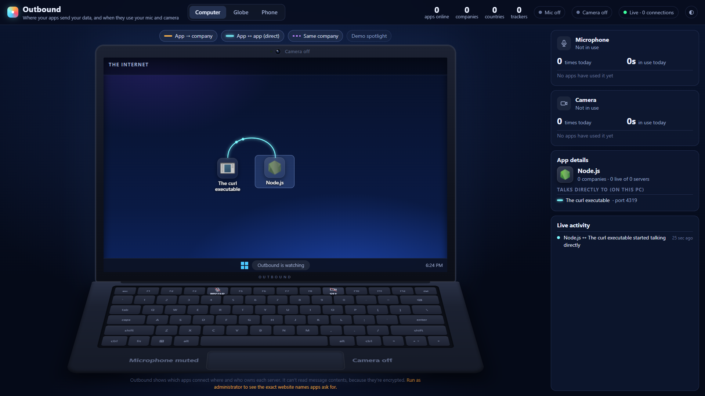

```text
  ___  _   _ _____ ____   ___  _   _ _   _ ____
 / _ \| | | |_   _| __ ) / _ \| | | | \ | |  _ \
| | | | | | | | | |  _ \| | | | | | |  \| | | | |
| |_| | |_| | | | | |_) | |_| | |_| | |\  | |_| |
 \___/ \___/  |_| |____/ \___/ \___/|_| \_|____/
   where your PC's data goes, who gets it, and what they were caught doing
```

Outbound is a local Windows dashboard for seeing where desktop apps connect, which apps are talking to each other, and when they use your microphone or camera. An opt-in scan reads what is already stored on the PC, and a sourced dossier shows what the companies behind those apps say they collect and what regulators and courts found. Click an app in Computer to inspect its destinations. Switch to Globe to see the estimated locations of those endpoints.

Built at Hack Western 13 for the **Discover the Unknown** theme.

## Views

| View | Key | What it shows |
| --- | --- | --- |
| Computer | 1 | A laptop with every app that has live connections, wires to the companies it reaches, app-to-app links (loopback TCP, parent/child, named pipes, local UDP, shared companies and trackers), live MIC and CAM keys, an exposure score per app, and a readable live feed. |
| Globe | 2 | Estimated destination locations, app labels and packet arcs, company HQ reference points, and markers for sourced incidents at each company's HQ. |
| Phone | 3 | The phone DNS gateway and Auth0 consent firewall (CIBA + FGA). |
| Stored data | 4 | **Scan this PC** (opt-in): visited domains per browser profile with previously observed tracker associations, tracker cookie domains (names only), Windows permission history (which apps used location, microphone, camera, contacts and when), installed software, startup entries and scheduled tasks, browser extensions allowed to read every site, Windows privacy settings, and app data on disk. |
| Dossier | 5 | Over 250 apps and 130 companies: what each says it collects, who it shares with, where data is stored, and verified court cases, fines, settlements and investigations, each with a source link. |
| Rules | 6 | Block an app, company or domain. A decision provider (local, or Auth0 CIBA + FGA) approves the rule and the enforcer shows the exact Windows Firewall command. The default is a dry run. |
| History | | Thirty days of per-app daily totals. |

## Privacy guarantees

- The server binds to `127.0.0.1` only. Nothing observed on the PC is sent anywhere.
- The stored-data scan runs only when you press **Scan this PC**. Browser history is reduced to domains. Cookie values, saved passwords, autofill and tokens are never read.
- Blocking is a dry run by default. Firewall rules are applied only when `OUTBOUND_ENFORCE=firewall` is set and the server runs elevated.
- Auth0 is off unless its variables are set in the gitignored `.env`. See [research/SETUP-AUTH0.md](research/SETUP-AUTH0.md).

## Architecture

```text
 Windows (read-only)                 server.js on 127.0.0.1                 browser views
 ------------------                  ----------------------                 -------------
 netstat / Get-NetTCPConnection --+
 Core Audio sessions (mic)        +--> collectors --> state --> SSE /events --> Computer, Globe
 Media Foundation (camera)        |    (lib/*.js)      |                         Stored data, Dossier
 process tree, pipes, UDP         |                    +--> /api/score, /api/history, /api/report
 registry, tasks, browser DBs  ---+--> opt-in scan ------> /api/scan (cached locally)
                                        public/data/research.json --> Dossier, badges, Globe incidents
 Rules view --> /api/policy --> provider: local | Auth0 (CIBA push -> FGA tuple)
                                  --> enforcer: dry-run | windows-firewall (elevated + opt-in)
```

## Data sources and licenses

- Tracker associations per site: [WhoTracks.Me](https://github.com/whotracksme/whotracks.me) measurements (CC BY 4.0) with [Ghostery TrackerDB](https://github.com/ghostery/trackerdb) metadata (CC BY-NC-SA 4.0, non-commercial). Details are recorded inside `public/data/site-trackers.json`.
- IP ownership and location: `@ip-location-db/asn` and `geoip-lite`, used offline.
- Domain grouping: the [Public Suffix List](https://publicsuffix.org/).
- Dossier: regulator decisions, court records, company privacy policies and press investigations. Each item links its source, and every source was fetched during the build. Method and rejected leads: [research/METHOD.md](research/METHOD.md), [research/rejected.md](research/rejected.md).

Because of the non-commercial TrackerDB terms, this repository ships without a blanket license.

## Team

TODO



The screenshot is scoped to a real local curl-to-Node.js test connection. The connection details show port 4319.

## Run

Use Windows 11, Node.js 24 and npm 11. From the integrated project checkout, run:

```text
npm install
npm run dev:all
```

Open [Desktop](http://127.0.0.1:4317/) and [Phone](http://127.0.0.1:4320/). If PowerShell blocks the npm shim, use `npm.cmd install` and `npm.cmd run dev:all`.

### Troubleshooting

- **Port already in use or a broken view after reload.** Close the old Outbound server in its terminal with Ctrl+C, then launch from the integrated checkout. Run `npm run check` to verify the page, its assets and the API on a free port.
- **Exact website names are missing.** If Windows restricts the DNS cache, try starting Outbound from an administrator terminal. IP ownership and reverse DNS remain available as fallbacks.
- **Phone configuration.** Copy `.env.example` to the gitignored `.env`. Keep the loopback defaults for a laptop run. For live Auth0, fill in the FGA store and model, the CIBA-enabled Auth0 application and enrolled user, and a generated `PHONE_POLICY_KEY`. Restart the gateway after editing `.env`. [Phone gateway setup](gateway/README.md)
- **Guardian approval never arrives.** Enroll the test approver in Auth0 Guardian and verify that the enrolled user's ID matches `AUTH0_USER_ID`. Keep the enrolled phone unlocked for the test. For an offline rehearsal, stop your gateway and use `npm run phone:demo` with hosted credentials omitted. [Guardian and offline demo instructions](gateway/README.md)

## What Outbound measures

- **Connections.** Windows reports TCP sockets and process IDs. Outbound counts connecting and established sockets and keeps observed destinations visible for ten minutes after they disappear. A shared-company link means two apps were observed connecting to the same attributed owner. A direct link joins the two Windows processes on a matched localhost TCP connection.
- **Owners and geography.** Outbound combines the Windows DNS cache, reverse DNS, offline network ownership tables and offline IP geolocation. Hostnames and locations can be approximate or unavailable. An owner may be a cloud or CDN operator, and a shared DNS cache entry can describe multiple apps' traffic. If Windows withholds the DNS cache, you can restart in an elevated terminal to try to get more hostnames.
- **Trackers.** A badge signals a match against known domains or organization names. Each match is an attribution clue about the endpoint.
- **Device use.** Outbound reads Windows Core Audio capture sessions and Media Foundation camera activity to identify active apps. It timestamps observed transitions, combines overlapping intervals for today's device time, and retains completed sessions locally. Session timing is sampled and history covers use observed while Outbound is running.

Polling can miss brief connections, including some short device sessions. UDP traffic such as QUIC is outside the TCP snapshot. The wires and arcs illustrate observed connections. Outbound captures neither packet payloads nor microphone or camera media, and it measures neither bytes nor traffic direction.

## Local data

The HTTP server binds to `127.0.0.1`. Network observations are held in memory, and device session history is saved to `data/usage.json` on the PC. Reverse DNS uses the Windows resolver. IP ownership and location data, the dashboard and its globe assets are served locally.

Use [DEMO.md](DEMO.md) for the live walkthrough and [DEVPOST.md](DEVPOST.md) for the submission draft.

Open `http://localhost:4317/api/report` for today's local Markdown summary, or `http://localhost:4317/api/report/download` to save it. Network totals cover today's observations from the current server run, including destinations removed from the live view.
