<div align="center">


<h3>See where your data goes. Then stop it.</h3>

<p>


<br>


</p>

**Outbound is a local Windows dashboard that shows which apps talk to whom, from where, and what regulators have found or alleged about them.**<br>
It watches live TCP endpoints, mic and camera use, and (if you opt in) stored browser and Windows metadata. It ties every company to sourced fines and cases, and it won't block anything until **you approve it on your phone** through Auth0.

[**▶ Watch the promo**](promo/outbound-promo-v4.mp4) · [Run it](#run) · [Architecture](#architecture) · [Demo script](DEMO.md) · [Devpost](DEVPOST.md)

</div>

---

## Why

<table>
<tr>
<td width="34%" valign="middle" align="center">

</td>
<td width="66%" valign="middle">

Your apps keep connections open in the background, often to companies you've never heard of, through servers in other countries. Privacy policies list the categories. Regulators fill in the rest.

Outbound puts it all on one screen, on your own machine:

- **Which apps** have open connections right now, and **where** those connections land.
- **Who's behind them**, from offline ASN data plus a dossier of public records.
- **What regulators and courts found or alleged**: fines, settlements and investigations, each linked to its regulator or court source.
- **A stop button that asks you first.** Blocking goes through Auth0 CIBA on your phone and is recorded as an Auth0 FGA tuple.

</td>
</tr>
</table>

<p align="center">
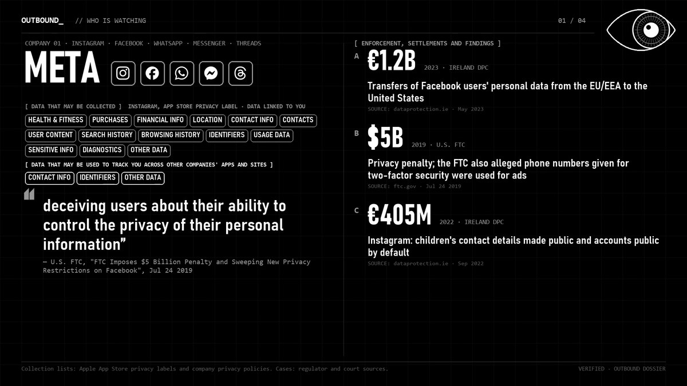
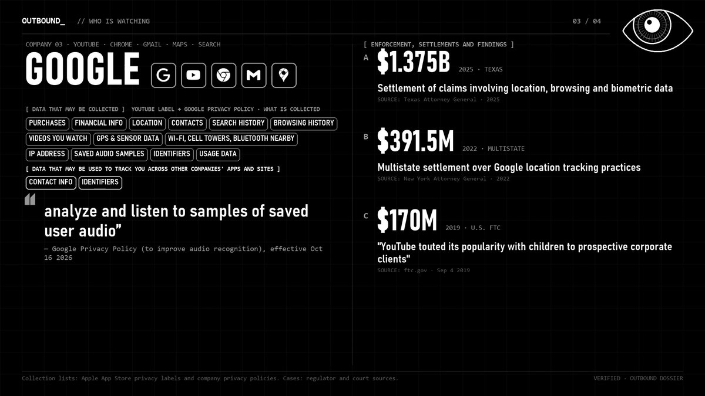
<br>
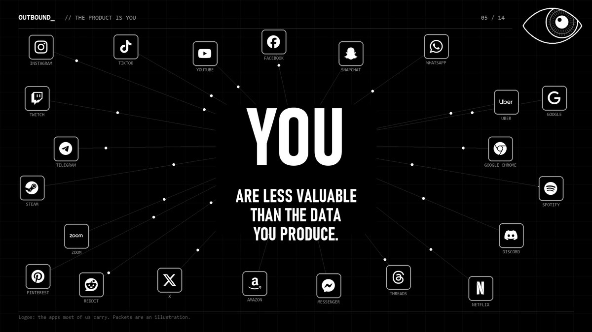
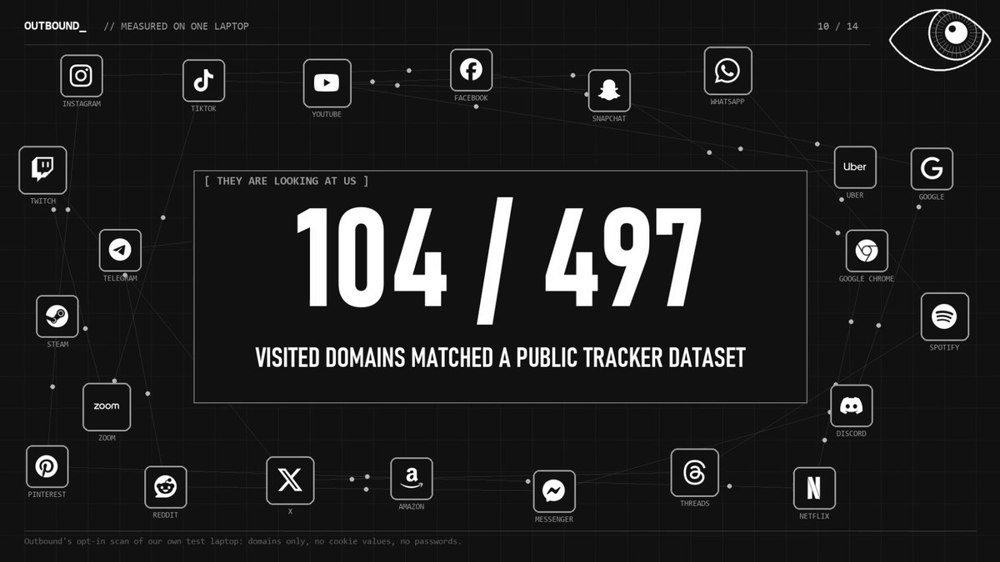
</p>

<p align="center"><sub>Frames from the <a href="promo/outbound-promo-v4.mp4">promo video</a>. Every fine, quote and figure is traced to its source in <a href="research/PROMO-SOURCES.md">research/PROMO-SOURCES.md</a>.</sub></p>

## The idea

Outbound makes every connection on your PC answer four questions:

| Question | Outbound layer |
| :-- | :-- |
| **Who is talking?** | The process graph, foreground app and `netstat`, sampled live and streamed over SSE |
| **Where does it go?** | Offline ASN and GeoLite2 estimates, drawn on a spinning globe with HQ reference points |
| **Who is behind it?** | A local dossier of 338 apps and 197 companies, with 240 sourced incidents |
| **Did you agree to that?** | Auth0 CIBA push approval, an Auth0 FGA consent tuple, then a Windows Firewall rule plan (dry run by default) |

<div align="center">
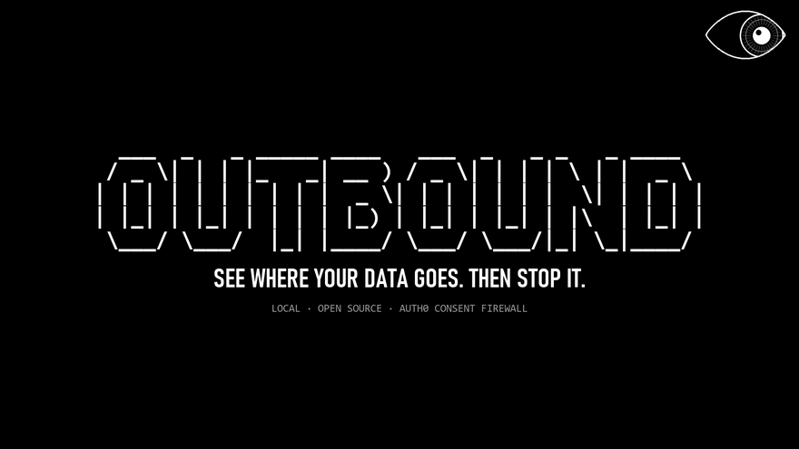
</div>

## Features

<table>
<tr>
<td width="50%" valign="top">
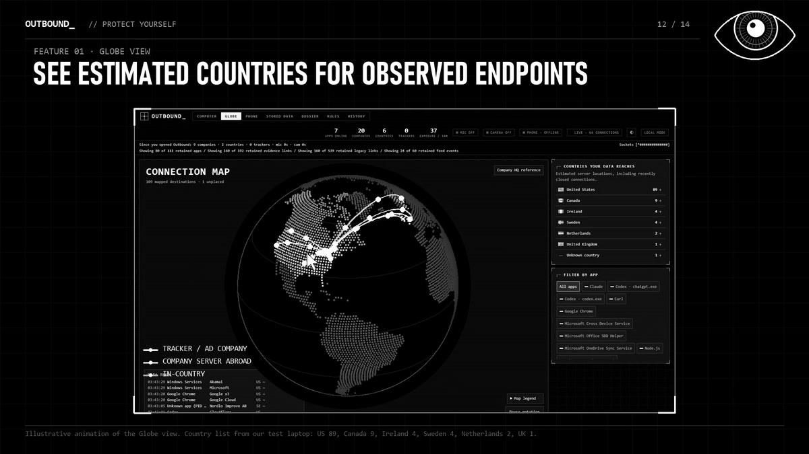
<h3>01 · Globe</h3>
Where your endpoints land: usable location estimates, illustrative arcs, company HQs, and links to the incidents tied to each one.
</td>
<td width="50%" valign="top">
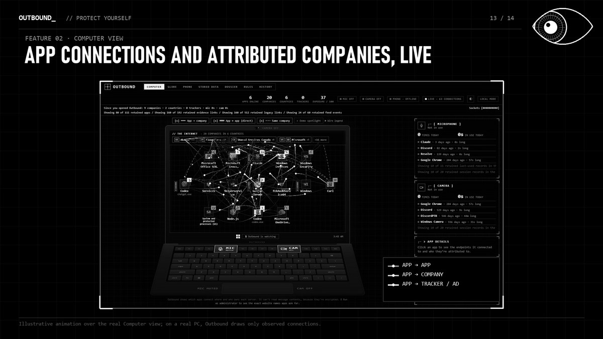
<h3>02 · Computer</h3>
Every running app with its live endpoints, background connections, MIC and CAM activity, and exposure factors. Observed sockets and inferred links are labelled separately.
</td>
</tr>
<tr>
<td width="50%" valign="top">
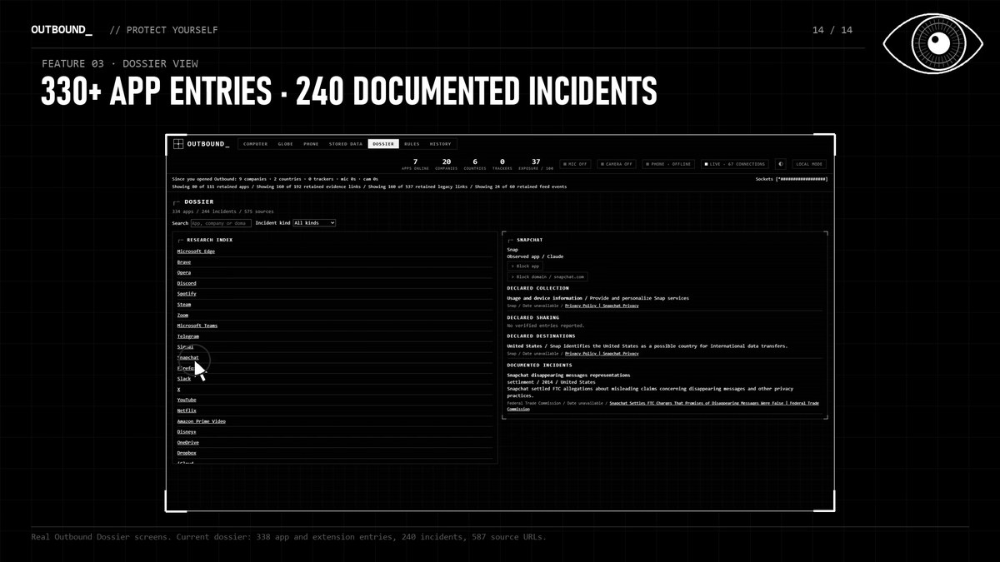
<h3>03 · Dossier</h3>
Company claims and documented incidents for 338 apps, each linked to the regulator, court, company or press record it came from.
</td>
<td width="50%" valign="top">
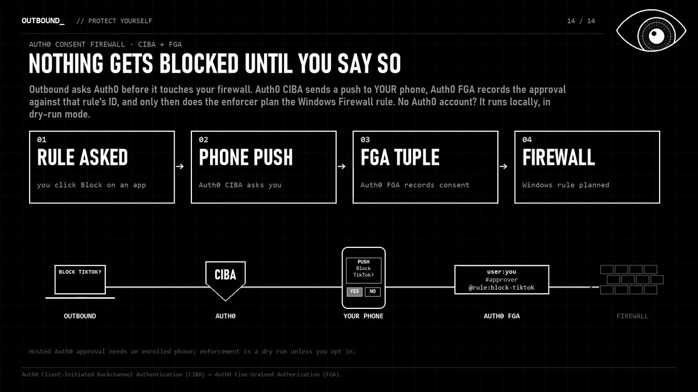
<h3>04 · Consent firewall</h3>
<b>Nothing gets blocked until you say so.</b> Auth0 CIBA sends a push to your phone, and Auth0 FGA records which rule you approved. The firewall rule stays a dry run unless you opt in.
</td>
</tr>
</table>

| View | Key | What it shows |
| --- | :-: | --- |
| **Computer** | `1` | Observed apps and endpoints, background connections, MIC and CAM activity, app exposure factors, and a live feed. Links distinguish observed local sockets from inferred relationships. |
| **Globe** | `2` | Usable endpoint location estimates with illustrative arcs, company HQ reference points, and links to sourced incidents. |
| **Phone** | | The DNS gateway and tracker consent demo. Hosted consent uses Auth0 CIBA with Guardian and timed FGA grants. |
| **Stored data** | `3` | The opt-in scan covers browser history domains, cookie hosts and counts, recorded Windows permission history, installed software, startup entries and tasks, extension permissions, privacy settings, and app-folder metadata. |
| **Dossier** | `4` | Sourced company claims, documented incidents, and links to original records. |
| **Rules** | `5` | Local or configured Auth0 policy decisions and Windows Firewall command previews. Dry run is the default. |
| **History** | `6` | The last seven recorded days in the UI, with up to 30 local days available through the API. |

<!-- dossier-counts:start -->
The dossier contains **338 apps**, **197 companies**, and **240 incident records**, with **587 distinct source URLs** across its records.
<!-- dossier-counts:end -->

Counts include incident records from app and company entries. Run `npm run docs:counts` after rebuilding [the dossier](public/data/research.json).

## Architecture

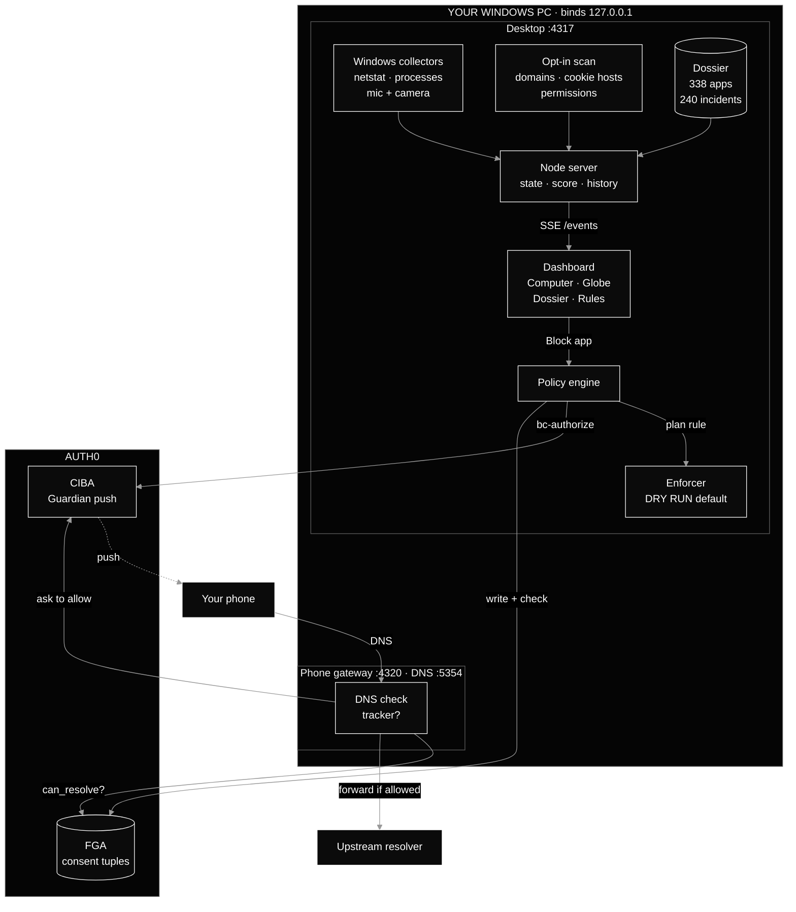

The desktop runs on its own. Without Auth0 settings, the policy engine uses a local provider and the enforcer only prints the firewall commands it would run. The phone gateway checks every DNS lookup before forwarding it:

1. **Not a tracker** → forward to the configured resolver.
2. **Tracker with an unexpired FGA grant** (`user can_resolve tracker`, condition `unexpired`) → forward, with the answer TTL set to 0 so the grant is checked again on the next lookup.
3. **Tracker without a grant** → answer `REFUSED`. From the Phone dashboard you can ask for access, which sends a CIBA push. An approval writes a timed FGA tuple.
4. **Tracker revealed by the answer** (CNAME cloaking) → checked again after the upstream replies, and refused if there's no grant.

One block, end to end:

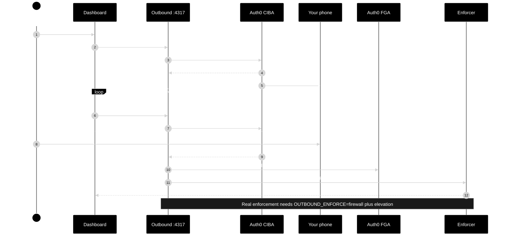

## Run

Use Windows 11 and Node.js 24. Run these commands from a repository checkout.

```powershell
npm install
npm run dev:all
```

Open [Desktop](http://127.0.0.1:4317/) and [Phone](http://127.0.0.1:4320/). If PowerShell blocks the npm shim, use `npm.cmd`. Use `npm start` for the desktop alone. `PORT` changes the desktop HTTP port. For a fresh clone with the checked-in lockfile, `npm ci` can install the dependencies.

<details>
<summary><b>Phone setup, Desktop Auth0 and troubleshooting</b></summary>

- **Phone setup.** Copy [`.env.example`](.env.example) to the gitignored `.env` when configuring the gateway. Phone defaults to loopback HTTP port `4320` and loopback UDP/TCP DNS port `5354`. The gateway loads `.env`. `npm run dev:all` enables desktop Phone polling and points it at the gateway. A standalone desktop polls only with `OUTBOUND_PHONE=1` or a loopback HTTP `PHONE_URL`. To run a second copy from a separate checkout, set `PORT`, `PHONE_DASHBOARD_PORT`, and `PHONE_DNS_PORT` to free ports in the shell before launch and open Phone at the chosen address. [Phone setup and offline demo](gateway/README.md)
- **Desktop Auth0.** Dashboard sign-in is optional with `AUTH0_LOGIN=1`. Desktop CIBA/FGA policy uses `OUTBOUND_FGA_MODEL_ID`, while Phone consent uses `FGA_MODEL_ID`. To load desktop settings from `.env`, launch with `node --env-file=.env server.js`. See the setup guide for callback URLs, Guardian enrollment, and the other required environment variables. [Desktop Auth0 setup](research/SETUP-AUTH0.md)
- **Troubleshooting.** If a port is busy, close the old Outbound process from its terminal. Use `npm run check` to verify desktop assets and routes on an ephemeral loopback port. The Windows DNS cache may require an elevated launch to expose more hostnames.

</details>

## Quick demo

1. In **Computer**, select a running app and point to an observed endpoint and its attribution. Use an observed local link if remote traffic is sparse.
2. In **Stored data**, run **Scan this PC** before the timer. When the scan is ready, open **Permission history** and show one recorded timestamp.
3. In **Dossier**, search **Tim Hortons** and click its result. Under **Documented incidents**, point to the mobile location investigation and its regulator source.
4. Return to **Computer** and choose **Block app** for a rehearsed app with a known executable path, then **Preview block**. Point to **DRY RUN**.
5. Click **Show app on globe**, then open a country row. Use **All apps** if the selected app has no mapped endpoints. [Judge’s guide](JUDGING.md) · [Three-minute script](DEMO.md)

## Privacy and limitations

> [!IMPORTANT]
> Outbound reads connection metadata only. It never inspects packet payloads, records mic or camera media, or reads password, autofill or token stores. Nothing leaves your PC unless you configure a resolver or Auth0.

- Desktop and Phone HTTP dashboards bind to `127.0.0.1`. The opt-in phone DNS listener can bind to a configured private adapter. Scan results, device sessions and recent history stay on the PC.
- The stored-data scan starts when requested. History is reduced to domains. SQLite cookie queries select hosts and counts. The scanner skips password, autofill and token stores and deletes its temporary database copies after reading.
- Offline ASN and geolocation data supply estimates. Windows reverse DNS can contact the configured resolver. Phone forwards DNS to its configured upstream, and optional hosted sign-in and approval contact Auth0. The desktop policy flow uses an approval reference and opaque FGA rule IDs.
- Rules preview changes by default. Firewall enforcement requires `OUTBOUND_ENFORCE=firewall`, elevation and a target the enforcer can resolve. The labeled Phone offline demo uses real loopback DNS with fixture answers and simulated approval decisions. Hosted approval through revocation remains unverified.
- Sampling can miss brief sockets and device sessions. TCP snapshots omit QUIC traffic. Endpoints can be attributed to a network or CDN provider, and shared owners and pipes can be inferred. The app measures connection metadata without inspecting packet payloads or recording device media.
- Browser tracker matches come from prior public measurements. Extension and autorun flags describe metadata. Registry access timestamps can outlast a running process, and a locked browser database can limit coverage.
- Exposure scores summarize observed factors and show coverage. Folder totals can be provisional, and cached scan results carry their collection time.

## Local API

| Endpoint | Purpose |
| --- | --- |
| `GET /api/state` | Current desktop snapshot, freshness, visible apps, links, and device state. |
| `GET /events` | SSE stream with the initial state, later updates, and heartbeat comments. |
| `GET /api/scan` · `POST /api/scan` | Read the current and retained scan results or start a new opt-in scan. Starting while a scan or its background folder walk is active returns 409. |
| `GET /api/scan/status` | Lightweight progress, section counts, and cached-result metadata. |
| `GET /api/score` | Overall and per-app exposure factors, reasons and coverage. |
| `GET /api/history` | Up to 30 local days of per-app aggregates. |
| `GET /api/report` · `GET /api/report/download` | Local Markdown report and attachment. |
| `GET /api/policy` | Read rules, command previews, and the configured provider and enforcer. |
| `POST /api/policy/rules` · `POST /api/policy/check` | Create a rule or check the decision for a target. |
| `GET /api/policy/requests/:id` · `DELETE /api/policy/rules/:id` | Poll an approval request or remove a rule. |
| `GET /auth/me` · `GET /auth/login` · `GET /auth/callback` · `GET /auth/logout` | Read desktop identity status and handle the optional Auth0 sign-in flow. |

The response contracts are documented in [notes/CONTRACT-v2.md](notes/CONTRACT-v2.md).

In local mode, `/auth/me` reports sign-in as disabled. The login, callback, and logout routes return 404 until sign-in is enabled. Approval polling requires a pending or retained Auth0 request ID.

## Data sources and licenses

- **Site tracker associations.** WhoTracks.Me measurements are CC BY 4.0. Ghostery TrackerDB metadata is CC BY-NC-SA 4.0. The combined subset in `public/data/site-trackers.json` retains these source notices and TrackerDB's non-commercial and share-alike terms. [WhoTracks.Me](https://github.com/whotracksme/whotracks.me) · [TrackerDB license](https://github.com/ghostery/trackerdb/blob/main/LICENSE)
- **ASN attribution.** The pinned `@ip-location-db/asn` package credits RouteViews, DB-IP and NRO under CC BY 4.0. Its publisher flags accuracy issues with the npm dataset. DB-IP asks for a link on pages that use its data. [ip-location-db](https://github.com/sapics/ip-location-db) · [RouteViews](https://www.routeviews.org/) · [DB-IP](https://db-ip.com/) · [NRO](https://www.nro.net/)
- **IP geolocation.** The installed `geoip-lite` package labels the library Apache-2.0 and the included GeoLite2 data CC BY-SA 4.0 in its license notice. This product includes GeoLite2 data created by MaxMind. Updated downloads carry their own terms. [geoip-lite](https://github.com/geoip-lite/node-geoip) · [MaxMind](https://www.maxmind.com/) · [GeoLite terms](https://www.maxmind.com/en/geolite/eula)
- **Domain grouping and map.** The vendored Public Suffix List is MPL-2.0. The Natural Earth polygons are public domain. [Public Suffix List](https://publicsuffix.org/list/) · [Natural Earth terms](https://www.naturalearthdata.com/about/terms-of-use/)
- **Dossier.** Claims link to their original regulator, court, company, or press sources. Consult each publisher's terms for reuse. [Research method](research/METHOD.md)
- **Logos in the promo and README frames** come from [simple-icons](https://simpleicons.org) (CC0). Brand names and logos belong to their owners. They are used only to identify the apps discussed.

The repository has source-specific data terms and no blanket license grant for the combined checkout.

## Verify

Run `npm test` for fixtures and `npm run check` for the desktop smoke test. GitHub Actions runs the fixture suite on Windows with Node 24. The live walkthrough and submission draft are in [DEMO.md](DEMO.md) and [DEVPOST.md](DEVPOST.md).

<details>
<summary><b>Performance replay</b></summary>

Use replay for local performance testing only. Use the live dashboard for demos. Record a fresh `/api/state` response from your own live desktop once the `apps` array contains 80 distinct apps. This example uses the default desktop port. Keep the recording in gitignored `data/` on this PC because it can contain local app and connection metadata.

```powershell
New-Item -ItemType Directory -Force data | Out-Null
curl.exe --fail --silent --show-error --output data/benchmark-state.json http://127.0.0.1:4317/api/state
```

Open a new shell and use a free loopback port for the replay.

```powershell
$env:PORT = '4319'
$env:OUTBOUND_FIXTURE = 'data/benchmark-state.json'
npm run fixture
```

Open `http://127.0.0.1:4319/`. The launcher requires the recording path. The dashboard header, `/api/state`, and SSE state show **FIXTURE DATA**. Every replay response includes `X-Outbound-Mode: FIXTURE DATA`. The server replays the original state without collecting new data or creating rules. Other API reads report that no recording is available and writes are disabled. After stopping the replay, clear the flag with `Remove-Item Env:OUTBOUND_FIXTURE` or close that shell before starting the live dashboard.

</details>

<div align="center">
<br>

<br>
<sub><b>OUTBOUND_</b> · built at Hack Western 13</sub>
</div>
